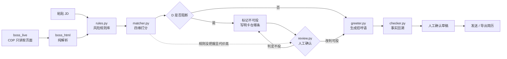

# JobPilot

把「找岗位 → 判断值不值得投 → 写招呼语 → 发送 → 跟进 → 出针对性简历」做成一个本地工作台。
核心不是多投几家，而是**让每一次投递都有据可查**。

> 起手背景：连续投了 19 家、全部零回复。复盘时发现问题不在话术，在岗位选择——
> 投过的里面有 3 家是培训机构、2 家是销售岗套壳、1 家卡 2028 届。
> 这些本来可以在一分钟里筛掉，但当时只靠肉眼读 JD。这个工具就是从那次复盘长出来的。

---

## 它解决什么问题

招聘网站上一条 JD 里藏着三类信息，肉眼读很费劲：

| 信息 | 例子 | 后果 |
|---|---|---|
| 硬约束冲突 | `6天/周`、`2028 届及以后` | 投了直接被筛，白花一次机会 |
| 伪装 | `零基础可冲`、`结业后拥有个人作品集`、行业写"在线教育" | 这是卖课的，不是招人 |
| 不可谈的时长 | `实习期 6 个月` 而你只有 3 个月 | 聊到二面才崩，浪费双方时间 |

JobPilot 把这三类做成规则，粘贴 JD 立刻给出分数、四维依据、命中的原文片段。
**分数不是模型给的**，是规则算的——因为分数要稳定、要能追问。

---

## 架构



一条设计分界线贯穿全项目：**判断归规则，表达归模型，事实归代码。**
规则判不准的那一小块交给人，但人只看规则拿不准、且判错代价高的那几条（见「人工确认」）。

---

## 快速开始

```bash
pip install -r requirements.txt
cp .env.example .env          # 按需改模型配置；config.py 会自己读这个文件
DEMO=1 python -m app          # DEMO 模式：不联网、不要 key
# 打开 http://127.0.0.1:8000
```

`.env` 由 `app/config.py` 里的 `_load_dotenv()` 在导入时读入，**零依赖、不覆盖进程里已有的值**。
所以两种写法都行，且命令行永远压得住文件：

```bash
python -m app                                   # 吃 .env
LLM_MODEL=agnes-2.5-flash python -m app         # 临时换模型，只影响这一次
```

DEMO 模式用 `demo/jobs.json` 里 7 条真实形态的 JD（含 2 个陷阱岗位和 1 条只有列表页信息的），
话术走模板兜底，**不需要任何 API key 也不需要登录**。
示例数据只在**空库**时灌入——库里已有真实抓取的职位时，`DEMO=1` 不会把它混进投递列表。

接真实数据（日常使用就是这个模式）：

```bash
python -m app.fetch -k "软件测试 实习" --city 南昌 --pages 1   # 抓取入库（要先有登录好的调试浏览器）
python -m app                                                  # 不带 DEMO：真实库 + 真实模型
```

两种情况只差一个环境变量，页面完全一样。区别在于：DEMO 走 `demo/jobs.json`、话术模板兜底、
`/fetch` 默认解析快照；不带 DEMO 时 `/fetch` 会真的去读浏览器，话术走模型（模型不可用时自动降级到模板）。

首次启动会按顺序找档案：`data/profile.json`（真实档案，已在 `.gitignore` 里排除）
→ `data/profile.example.json`（脱敏示例）。想用自己的信息：

```bash
cp data/profile.example.json data/profile.json   # 然后改里面的字段
```

素材里 `verified` 为 false 的，既不进招呼语也不进简历——这条是硬约束，
不是开关：模型根本看不到未勾选的内容，比事后检查更彻底。
（启动后建库只做一次，改完 JSON 要重新初始化：删掉 `data/jobpilot.db` 再启动。）

离线自检（不启动服务、不联网）：

```bash
python selftest.py              # 主链：打分 / 规则 / 事实校验 / 问 HR 话术，37 项
python selftest_adversarial.py  # 召回：换种说法能不能绕过，23 项
python selftest_precision.py    # 精度：正常岗位有没有被误伤，23 项
python selftest_fetch.py        # 抓取解析：字段级断言，53 项（含真实快照）
python selftest_review.py       # 人工确认：改判生效 / 重算不丢 / 撤销可回 / 等回复不改判定，38 项
python selftest_pipeline.py     # 投递跟进：状态机 / 时效 / 抽取 / 采信改分 / 一致性 / 提醒，93 项
python selftest_chase.py        # 统一催办：话术不编造 / 名单只收该催的 / 记账幂等，17 项
```

这是最省事的验收方式——面试官 clone 后第一条命令就能看到结果。
抓取自检单列的原因：它最容易「看起来跑通了其实解析全空」，不报错，只是没抓到东西，
所以逐字段断言，而不是只看条数。

**召回与精度必须分开测，这是被实际情况逼出来的。**

`selftest_adversarial.py` 的 20 条是按规则反向构造的（先读规则，再写绕得过去的 JD），
把漏判从 100% 压到 0。紧接着拿 19 条正常 JD 反向验，**19 条全部被误伤**——
只测召回，规则会一路加词，最后把所有岗位都判死。

所以 `selftest_precision.py` 单独存在，19 条正常 JD + 4 条「孪生样本」：
同样模板只把关键词换成真违规，必须仍然拦住。只看前一半的话，
把所有规则删光就能全绿——精度和召回必须一起验，
否则「变准了」和「变松了」在测试上无法区分。

三套的分工一句话：

| 脚本 | 回答的问题 |
|---|---|
| `selftest.py` | 正常流程有没有被改坏 |
| `selftest_adversarial.py` | 换个说法还拦不拦得住 |
| `selftest_precision.py` | 正常岗位会不会被误杀 |
| `selftest_review.py` | 人工改判会不会失效 |

---

## 人工确认（P2）

规则是纯函数：同一份 JD 永远同一个判断。但「永远一致」不等于「永远正确」，
而规则判错的时候**不会报错**——它只会安静地把一个对口岗位压到 40 分，
而 40 分意味着你不会再点开它。这种错必须由人补上，可又不能退回「所有岗位都靠肉眼」。

所以「待确认」只放两类岗位：**规则没把握的**，和**判错代价高的**。

判错的代价不对称，队列因此不按分数排：

| 分组 | 触发条件 | 判错的代价 |
|---|---|---|
| 规则可能判重了 | 命中招生／销售话术类**推断型**规则，且方向分 ≥ 30 | 损失一个能投的岗位，而且你不会知道 |
| 事实型阻断 | 硬阻断来自 JD 原文的一句硬话（工时／届别），且方向分 ≥ 30 | 只是少看一眼 |
| 关键信息缺失 | JD 没写工作时间，这项不参与打分 | 分数里缺了一块 |

方向分低于 30 的岗位根本不进队列——规则就算判错，你也不会投，
塞进待办只是制造负担。**取舍标准不是「规则有没有把握」，而是「这条值不值得你花两分钟」。**

四种操作：`改判可投`（推翻规则）、`判定不投`（人否决规则放行）、`认可规则`（结论已定，移出队列）、
`在等回复`（已去问，答案还没来）。每条都能写备注、能撤销，历次判断全部留痕。

`在等回复` 只出现在「关键信息缺失」这一组：工时写在 HR 脑子里，规则永远拿不到。
它把岗位移出队列，但**分数一分不动**——等待不是证据，凭什么改分；等答复到了，
把答案补进 JD 重新评估，规则自己会判成双休还是单休。所以这个状态不是「已解决」，
它单独列一栏、显示等了几天，超三天标「该催了」。撤销它等于承认还没问到，回到队列。

五条工程约束，都在 `selftest_review.py` 里逐条断言：

1. **override 按规则 id 生效，不给职位发免死金牌。** 记下的是「当时命中、被你推翻的那几条」；
   规则以后升级出的新命中照样拦得住。否则一次「我认了」会把后面所有问题一起放过。
2. **override 在 `score_only()` 里读，不写进 Match。** 点「重新评估」不会把人的判断冲掉——
   否则人工结论只活到下一次重算，而这个项目里重算每天都在发生。
3. **人工只推翻风险判断，不碰方向分。** 「这不是培训机构」不等于「这岗对口」：
   相关性归规则，真实性归人。
4. **撤销回到纯规则，历史不删。** 被问起「你的分数为什么和规则算的不一样」时要翻得出来。
5. **JD 一改，人工判断自动作废。** 人是对着那段文字下的结论；补录了新的 JD 之后
   旧结论没有依据了（新正文里可能就写着单休），所以记一条 `reset` 让它重新回到队列，
   旧判断留在历史里但不生效。这条比「保留旧判断」更保守，也更容易解释。

自检还顺带抓到一个真 bug：`matches` 是 `lazy="selectin"` 的集合，一旦访问过就缓存在
`Job` 上，之后再落新 Match，`job.latest_match` 仍返回旧的最后一条。表现是「改判后分数没变」。
请求级 session 掩盖了它——同一个 session 里连续评估两次才会露出来，所以修法是
`evaluate_job()` 落库后 `db.refresh(job)`。

页面：`/review`。DEMO 数据里 7 条岗位有 4 条进队列，正好覆盖三个分组；
云诊（干净）、恒信（销售，方向 0 分）、联维（方向 15 分）都不进——
不是漏了，是按上面的规则不该问。

### 问 HR 的话术（`asks.py`）

缺口那一组的岗位，答案不在 JD 里，也不在规则里——只能问。所以卡片上有一条
「生成问 HR 的话术」，点开就是一段能整段复制的话：

> 你好，我是智能科学与技术专业 2027 届本科，11月23日可以到岗，能连续做到2027年2月28日。
>
> 看到「软件测试」这个岗位，想先确认两件事：
> 1. 每周需要到岗几天？周末是否双休？
> 2. 实习期满可以开实习证明吗？

三个设计决定：

1. **不用模型。** `greeter.py` 解决「怎么让对方愿意回你」，那是表达问题，要模型；
   这里解决「问什么才能把这条岗定下来」，是事实问题。模型在这件事上只会帮倒忙——
   它会把两个问题写成六句客套，而 Boss 上第一条消息越长越没人回。
2. **问题由规则决定，不写死。** `_QUESTIONS` 以 `rule_id` 为键，命中哪条 gap 就问哪句。
   规则库以后多一条缺口，这里自动多一问。触发条件只看缺口——实习证明人人要问，
   但它是附加项不是触发项，否则这个功能就退化成话术模板库。
3. **「双休」不能单独问。** 3 天/周也叫双休，但按那个天数凑满 40 个打卡工作日要十几周。
   所以问的是「每周到岗几天？周末是否双休？」——一句话问到两个维度。

生成完照样过一遍 `checker`：这段话里只该出现档案里有的数字（届别、到岗日期），
校验成本是零，漏掉一次就是硬伤。

---

## 投递跟进（P3）

P1 抓岗位，P2 判断值不值得投。P3 处理「发出去之后」——这一段有自己的失效方式，
而且都不报错：

1. **对方回了，我没看见。** HR 问「明天方便来面试吗」，你隔两天才看到。
   这跟漏看消息无关，是没有人替你把「这条现在轮到你」算出来。
2. **发出去就忘了。** 40 条发完，谁回了、谁没回、谁该催第二次，靠翻 Boss 的列表
   靠不住——它按时间排，不按「欠了多久」排。

所以这一层的第一性问题不是「记录了什么」，而是：**这条岗位现在卡在谁手上。**

```
me    等你动作（还没投 / 人家回了你还没回）
them  等对方（招呼已发 / 面完了等结果）
done  已经结束（给了 offer / 拒了 / 彻底没回音）
```

`/inbox` 就按这个分组，不按分数。**85 分还没投的，没有 60 分但 HR 等你回话的急**——
后者有时效，前者没有。按分数排会让前者永远压住后者，那是把「挑好的」和「别错过」
混成一件事。

### 状态机

```
new → scored → greeted → replied → interview → offer
        ↓         ↓         ↓           ↓
      blocked  ghosted   rejected ←─────┘
```

九条合法转移写在 `pipeline.TRANSITIONS` 表里，`set_stage()` 只放行表内的边。
写在表里而不是散在路由里，一是能自检（每个状态的按钮都断言合法），
二是逼人想清楚「这一步真的会发生吗」——`greeted → offer`（没面试就发 offer）
就该被拦住。

三条推导出来的规则：

- **状态由事实推进，不靠人点。** 记一条对方的回复，状态自己变成 `replied`。
  要人手动维护的状态，三天后一定是错的。
- **已投递的岗位不会被重算打回 `blocked`。** HR 回话说每周 6 天、采信后规则判阻断——
  但消息已经发出去了，把 `replied` 改成 `blocked` 等于假装没投过，跟进板上这条会凭空消失。
  阻断信息留在 `Match.blocked_reason` 里，状态归 `pipeline` 管。
- **`audit()` 会报出状态和会话对不上的岗位，但不自动修。** `phantom`（说投过了却一条
  发出去的消息都没有）会让它永远排在「等对方」，你于是在等一个不存在的回复；
  `stale`（发过消息、状态还停在待投）会让它永远不被催。修要判断哪一边是真的，
  自动改任一边都会把「当时到底发生了什么」永久抹掉。

### 回复 → 事实 → 重判

粘一条 HR 的原话进来，会抽出工时、薪资、实习证明这些能定下来的事，**每条都带原文引用**：

> 每周 5 天（原文「我们双休，每周5天」）
> 实习证明：可以开（原文「可以开实习证明」）

但**抽取不自动生效**。抽取是纯函数、可复现；采信是判断，得有人拍板。
HR 说「双休」而 JD 写着「单休」时，谁对不是代码能决定的。

采信之后写进 `Job.hr_facts_json`，存的不只是值：

```json
{"days_per_week": {"value": 5, "quote": "每周5天", "message_id": 12, "at": "2026-11-17T21:30:00"}}
```

打分时 `_schedule_text()` 的优先级是 **HR 口述 > 平台字段 > JD 正文**。HR 排最前，
因为它是唯一能覆盖平台标注的；但**一旦人采信了，打分就必须跟着走**——否则采信按钮
等于没生效，而「点了没反应」的按钮最难查（P2 已经踩过一次）。

为什么不直接改 `jd_text`：JD 原文是证据，改了就再也说不清「当时写的是什么」。

### 时效

`FOLLOWUP_AFTER_HOURS=18` 之前定义了但全项目没读过。现在它是真实的判据：

| 判据 | 阈值 | 含义 |
|---|---|---|
| 该催 | 发出 18h 无回 | 可以催一次 |
| 久无回音 | 发出 72h（4×）无回 | 别再等 |
| 你拖了 | 对方回了 24h 你还没回 | 每多一小时，回复率掉一截 |

### 提醒

`/inbox` 是「你打开才看得到」的。这一层真正会漏掉的场景恰好是——你压根没打开它。
所以「现在轮到你」做成了一条命令：

```bash
python -m app.remind            # 有人等你回就打印出来
python -m app.remind --json     # 给别的脚本消费
python -m app.remind --quiet    # 没提醒就不出声，适合挂定时任务
```

```
现在轮到你：2 条

  [久无回音] 某公司 · 软件测试实习
          发出 3 天没回音，基本可以作罢　（已发消息，等回音）

  [该催了] 另一家 · 测试助理
          发出 21 小时没回音，可以催一次　（已发消息，等回音）
```

有待处理提醒时退出码是 1，没有是 0，外壳里可以直接 `||` 分支。
Windows 上挂计划任务：

```bat
schtasks /create /tn JobPilot提醒 /tr "python -m app.remind" /sc hourly /mo 4
```

提醒和看板**不是一回事**，别合并：

| | 说的是 | 生命周期 |
|---|---|---|
| 看板分组 | 此刻卡在谁手上 | 一直在，跟着事实变 |
| 提醒 | 有一件事要你做 | 处理完就消失 |

混在一起的后果是可预料的：同一句「该催了」在页面上挂三天，你学会无视这一栏；
等它真凉了，你也不会再多看一眼。**提醒系统的失效方式从来不是「没弹出来」，而是弹了太多次同一件事。**

三种提醒，`kind` 由时间账决定，一条岗位同一时刻只出一种：

| kind | 触发 | 说什么 |
|---|---|---|
| `chase` | 发出 18h 无回 | 可以催一次 |
| `cold` | 发出 72h 无回 | 基本作罢（`chase` 自动作废） |
| `overdue` | 对方回了 24h 你没回 | 这条最急，排最前 |

三条规则，每条都对应一种「提醒悄悄失效」的方式：

- **幂等。** 同一情形只建一条，查十次也不会积出十条。重复是提醒失效的头号原因。
- **「知道了」是安静 12 小时，不是永久静音**（`ALERT_SNOOZE_HOURS`）。点一次就再也收不到，
  比没有提醒更糟：你以为什么都不缺，其实是全被自己关掉了。
- **一轮的边界是「我又发了一条消息」。** 重新打了招呼、又催了一次就是新的一轮，
  上一轮说过的「知道了」压不住这一轮；反过来，状态推进、收到回复时提醒立刻作废，
  且不设 snooze——**这些提醒背后的情形已经不存在了，不是「你知道了」**。

提醒落库在 `alerts` 表，关掉不等于删掉：`ack_at` 留着，出事能回溯。

### 统一催一轮（`app.chase`）

提醒只负责喊你，真正动手的那一下还有一个坑：**九条岗位、九个会话、同一句话。**
人手点不是打字累，是点完就忘了记账——消息发出去了，库里还停在「等回音（18 小时前）」，
明天照催，而你会以为是系统坏了。

```bash
python -m app.chase                 # 看名单和话术，不改任何东西
python -m app.chase --json          # 给自动化消费
python -m app.chase --sent 36 37    # 发完了，记一笔
```

`--sent` 做两件事：把这句话记成一条 out 消息（时钟自然重置，18 小时后才重新进名单），
并把该岗位还挂着的提醒关掉。**记账幂等**——同一句话不会记第二遍，否则重跑一次就多发一遍。

话术里的日期从 `preferences.available_from/available_to` 读，不写在文案里。
理由很朴素：这两个日期改了，九条话术不会跟着一起变成假话。`selftest_chase.py`
专门盯着这一条，顺带盯着「不含没有出处的承诺」。

要不要让它自己发？**发送这一步仍然交给人或浏览器自动化，命令只准备话术和记账。**
把「说什么」和「发出去」分开，是因为后者出错的方式（点错人、发重、被风控）需要当场看见，
而前者可以提前审。

### 回复草稿

按意图给一句可复制的话，意图靠关键词定：约面 / 问时间 / 问薪资 / 问情况 / 拒绝 / 告知 / 看不懂。
拒绝和看不懂**故意不给模板**——前者不用回，后者模板一定是错方向。

模板只引档案里 verified 的事实。占位符缺一个就整句不发：「我智能科学与技术届，可以到岗」
这种残句发出去，比不发更糟，对方能看出这是脚本拼的。

### 渠道取舍：BOSS 紧，猎聘松

两个渠道的岗位池不是一回事，用同一套硬约束去筛，结论会反过来。

- **BOSS 是主池**。南昌的测试实习基本都在这里，但两周没上新，池子已经被翻过一遍。
  这一边保持原样：双休、可远程面、能开证明，三条都卡。
- **猎聘是补位，只卡一条：能不能签三方实习协议。** 猎聘南昌的实习岗位极薄
  （实测一页里能看的只有销售／打杂），如果还叠加双休和远程面，等于把仅有的几条也筛掉。
  所以在这一边，单休可以谈、必须现场面也可以谈——**只要对方愿意签三方，就值得开一句口**。

这条不是放宽标准，是承认两个池子的供给不一样：主池卡严是因为还有得挑，
补位放宽是因为本来就没得挑。判断谁该收、谁该放，看的是「还有没有别的选择」，
不是「这家公司好不好」。

---

## 抓取职位（P1）

三种用法，从安全到方便：

```bash
# 1. 离线：解析已保存的 HTML 快照。不联网、不开浏览器
python -m app.fetch --snapshot fixtures/boss/list_page.html \
    --snapshot-detail fixtures/boss/detail_page.html --dry-run
#   → 15 条真实职位，第一条带完整 JD（137 字）并按规则打分

# 2. 读你自己登录好的浏览器（推荐）
#    先起一个带调试端口的 Edge，在里面登录 BOSS：
#    msedge.exe --remote-debugging-port=9222 --user-data-dir="%TEMP%\edge-cdp"
python -m app.fetch -k "AI应用开发 实习" --city 南昌 --pages 2

# 3. 存一份快照，给解析器留回归样本
python -m app.fetch -k "实习" --dump fixtures/boss/real
```

网页上也有入口：`http://127.0.0.1:8000/fetch`，DEMO 模式默认走快照，不联网也能演示。

**边界写死在代码里**：脚本只读页面。不登录、不碰验证码、不点「立即沟通」。
撞上登录墙或安全验证就抛 `NeedHumanError` 停下，让人去处理——
绕验证是账号被封最快的路，而自动投递是另一件产品的事。

抓取不需要装 playwright：`sources/cdp.py` 直接用 `websockets`（80KB）说 CDP 协议，
`pip install -r requirements.txt` 就够。**用无头浏览器会被 BOSS 拦**（实测会跳转验证），
必须在正常窗口里跑。

### 真实页面推翻了四个假设

`fixtures/boss/*.html` 现在是 2026-11-17 用登录态抓下来的真实页面（只把账号昵称换成了占位符）。
换掉手写快照之后，之前那套「照着理解写的」解析器一次暴露四个问题：

| 假设 | 真实情况 | 代价 |
|---|---|---|
| 搜索页是 `/web/geek/job` | 是 `/web/geek/jobs`（复数） | 单数能打开、也带登录态，但重定向回首页，一张卡片都没有 |
| 卡片靠 `job-card-wrapper` 认 | 是 `li.job-card-box`，而且直接挂在 `ul` 下（中间夹着一层 `div`，HTML 不合法但浏览器容忍） | 选择器全不命中，稳定返回 0 条 |
| `?page=N` 能翻页 | **第 2 页和第 1 页内容完全一样** | 所谓「翻 N 页」拿到的是同一批数据 N 次 |
| 薪资在 DOM 里是文本 | 数字被换成自定义字体的私用区字符（`U+E031`–`U+E03A`），`8-13K` 在源码里是 `-K` | 不处理就是一堆乱码 |

对应的处理：

- **翻页改成滚动**。列表是懒加载的，`--pages` 换算成目标条数（每屏 15 条），滚够为止。
- **列表页薪资直接丢弃，等详情页**。字体映射表每次请求都变，硬编一张表属于「偶尔对」；
  详情页的 `.salary` 是明文，而本项目本来就逐条进详情页，不用额外代价换来准确。
- **反爬文本在 `clean_text()` 里统一还原**：删掉插在词中间的「BOSS直聘」水印
  （`公<span>BOSS直聘</span>司直招` → `公司直招`），把康熙部首区的同形字归一回标准汉字
  （`⾛`→`走`、`⽆`→`无`）。不还原的话，关键词匹配会对不上，这些话术也会带着错字进简历。
- **渲染判据从 `readyState` 改成「目标选择器出现」**。Vue 页面 `complete` 时只有骨架，
  旧版「卡片数不再增加就退出」的逻辑在 0 张时立刻退出——总共等了 700ms，
  抓回来的空骨架被当成「没有职位」。这类 bug 不报错，只是安静地少抓。

真实抓取的收获不止是「能跑」：南昌搜「AI应用开发 实习」，15 条里 5 条被硬阻断——
4 条单休（其中一条 JD 没写，是平台字段 `6天/周` 露出来的），1 条是「线上远程兼职、
每周不低于 3 小时」，而它在修复前拿了全场最高分 69.4。**分数最高不等于最该投。**

---

## 技术决策与取舍

**1. 用规则打分，不用模型打分**
分数要稳定（同一份 JD 今天 72 明天 68，用户就没法信任）、要可拆（用户会问"为什么 62"）、
要能离线跑（DEMO 不配 key 也得给分）。模型只在生成话术时出场。

**2. 方向与风险是否决项，不是加分项**
第一版用加权求和，结果培训机构拿了 67.8 分——因为"门槛"和"风险"两项基础分都给得高，
把方向分低的窟窿补上了。改成给总分设上限（命中高风险规则封顶 40）才符合直觉。
**调整权重治不了"三项及格一项极差"这种结构性问题，只能设上限。**

**3. 事实回溯放在代码层，不只靠 prompt**
提示词里写"不许编造"的遵从率大概九成，漏的那一成恰好出现在最不该出现的地方。
所以两道：`checker.py` 用规则抓数字/证书/学校层次（确定性、零延迟），
再可选调一次模型抓语义层面的过度概括。任何 block 级问题都不许导出。

**4. 单文件前端，不上 Vue**
单用户本地工具只有五个屏，SPA 的收益抵不过"clone 下来要 npm install"的成本。
DEMO 能不能一条命令跑起来，比技术栈时髦重要。

**5. 未核验素材不进生成链路**
`ProfileItem.verified` 不是装饰字段，它决定素材能不能被模型看见。
模型看不到未核实的素材，也就不会引用它——这比事后检查更彻底。

**6. 规则要判的是「事情」，不是「字」**

这条规则改了三轮，每一轮都是被真实数据推翻的：

| 轮次 | 判据 | 结果 |
|---|---|---|
| 一 | 数命中几个词 | 20 条对抗 JD **漏判 20/20**——话术换个说法就归零 |
| 二 | 按维度组合判 | 漏判归零，但 19 条正常 JD **误伤 19/19** |
| 三 | 加入语境：否定、指代、证据强度 | 漏判 0，误伤 0 |
| 四 | 接入真实抓取数据（15 条） | 补上两条**测试集里根本没有的**规则：平台工时字段、兼职/远程 |
| 五 | 换成整库真实数据（35 条） | 又三条：经验年限的写法、销售岗被技术词豁免、水印变体劈开词 |

第二轮的修法没错但不够：它解决了「换个说法」，没解决「换个语境」。第三轮补的三件事——

| 缺陷 | 典型原句 | 修法 |
|---|---|---|
| 否定失明 | 「公司**不**实行单休」「入职**不**收取任何押金、培训费」 | 匹配点同句内出现不/无/未/免即作废，否定在前往后都要查 |
| 指代错位 | 「第 **28** 届上海国际电影节」「带教**导师**均有 1 年以上经验」 | 序数词后的届次不算毕业年份；经验的主语是导师就不是门槛 |
| 证据不分轻重 | 「管培生 + 轮岗学习」两个包装词就定案 | 销售要 ≥2 条硬证据（提成/回款/陌拜）；培训机构要**出现向候选人收费** |

第三轮里最重要的一条判断是机构培训的：**判据从「命中几维」改成「有没有向候选人收钱」**。
20 条真实卖课 JD 全部写了学费/实训费/集训营费——钱才是硬内核。
没有钱，就只是带教写得好一点的正常企业，或者一个真实的教研实习岗。

同一件事的写法可以变，语境也可以变，但「先收你钱 + 不签劳动合同 + 承诺推荐就业」
这件事变不了。**判据要贴着事情本身，不能贴着字。**

第四轮和前三轮不一样：前三轮都是「自己写的集子打自己」，第四轮是**真实数据打脸**。
15 条真实 JD 跑下来，有一条「线上远程兼职、每周不低于 3 小时」的数据标注岗拿了全场
最高分 69.4——不单休、不销售、不卡届别，规则一条都没命中。它的问题不在措辞里，
在「它根本不是全职」这件事上，而这一条在对抗集和精度集里都不存在：
**测试集的盲区，只有真实数据能照出来。**

顺带发现第二个盲区：BOSS 把工时写在详情页的 `text-experiece` 字段里（`6天/周 6个月`），
和「经验要求」共用同一个 DOM 节点。之前整段当经验读，于是「6 天/周」这行最硬的单休证据
被当成「经验：6天/周 6个月」扔掉了。现在按内容分流：含 `天/周` 或 `个月` 归工时，否则归经验。

第五轮把示例数据整个换成真实库（35 条），又照出三条，**三条都出现在分数最高的那几条里**：

| 缺陷 | 真实原句 | 为什么以前没发现 |
|---|---|---|
| 经验年限读漏 | 「拥有 **2年以上**AI应用开发**相关经验**」 | 旧正则要求「X年以上」和「经验」紧挨着；夹了领域词就漏。这条是全场最高分 93 的岗位，实际是按社招筛人 |
| 销售岗被技术词豁免 | 「**B端销售顾问**（AI独角兽企业）」，正文电销获客、阶梯提成 | 「技术词=0」这个豁免前提在卖 AI 产品的销售岗面前自我瓦解：通篇大模型/SaaS/智能体，于是 76 分 |
| 水印劈开词 | 「验`<span>来自BOSS直聘</span>`证」→ JD 里成了「验来自证」 | 水印词表只枚举了「BOSS直聘/直聘」，没料到还有「来自BOSS直聘」，于是整段 JD 带错字 |

三条的修法都不加新词表：经验改成允许中间夹 12 个非断句字符；销售改成「标题是销售 + 正文有 ≥2 条硬证据」就不再
看技术词（但只出现一个「业绩」不算，否则「销售数据分析实习生」会被误伤）；水印改成按「短文本 + 以『直聘』结尾」
识别，变体再多也是同一个后缀。

**一个值得记住的规律：规则出问题，最先暴露在高分岗上。** 漏判等于给错误岗位发高分，
误伤等于把好岗位压到 40 分——两种错都恰好落在「你会点开的那几条」上。
所以每次换数据源，先看榜首，比看全量分布有效。

两批外部产出我都复核过，各有一处没照单全收：
对抗集里「27/28 届均可，优先 28 届」对方判硬阻断，我降为提示——用户 27 届本来就能投；
精度集里「大二、大三在读亦可投递，2027 届优先」对方判硬阻断，我判可投——句子里明写了用户这一届。
**误判成本不对等的不能一刀切**，理由写在两个 cases 文件各自 note 里。

**7. 抓取只接管已登录的浏览器，不模拟登录**

BOSS 的登录是短信 + 滑块，脚本去模拟等于同时踩风控和法律两条线，
账号被封是小事，拿这个当作品集交付是大事。所以 `boss_live.py` 只做一件事：
通过 CDP 连上**真人已经打开、已经登录**的浏览器，把页面读下来。登录态、cookie 一次都不碰。

也没引 playwright：它 34MB，而这件事只要「开标签页 → 导航 → 等加载 → 读 outerHTML」四步，
`sources/cdp.py` 用 `websockets`（80KB）直接说协议就够了。顺带的好处是**「只读」变得可验证**——
那个文件里只有 `Runtime.evaluate` 读 DOM，没有任何输入模拟，一眼看得出它不会替你投递。

**8. 取页面和解析页面分成两层**

`boss_live.py` 负责网络、风控、节流；`boss_html.py` 只吃 HTML 字符串。
好处是三件事：解析器能在不联网的情况下单测；真实页面能存成快照，
站点改版时在本地复现而不是靠猜；换站点只写新 parser，入库链路不动。

解析器本身也刻意「缺字段不猜」——宁可公司名留空、在界面上标出来，
也不从别处凑一个。猜错的公司名会直接写进招呼语，而事后没人会发现。
配套的代价是：没拿到 JD 时门槛和风险两项都是「没看见问题」而不是「没有问题」，
加权出来会得到一个虚高的中间分（实测空 JD 能到 55），所以 `matcher.py` 给 JD 不足 60 字的
加强制上限 45 分，并在理由里写明「方向无法判断」。

---

## 已知限制

- **抓取依赖页面结构**。解析器按 class 语义找（`job-card-box` / `job-name` / `job-sec-text`），
  站点改版会失效。失效的表现是「静默返回空列表」而不是报错，所以配了真实快照回归：
  用 `--dump` 存一份新页面，跑 `selftest_fetch.py` 就知道解析器还认不认。
  没有做「反反爬」——撞墙就停，交给人。
- **列表页薪资不解析**。BOSS 把薪资数字换成了自定义字体的私用区字符，映射表每次请求都变。
  硬解属于「偶尔对」，所以列表阶段宁可留空，等详情页的明文（也就是必须进详情页才有薪资）。
- **快照会过期**。`fixtures/boss/*.html` 是 2026-11-17 的页面，站点改版后它既能证明解析器坏在哪，
  也会成为唯一能复现的证据；但别把它当成「现在的页面长这样」。
- **规则库的语境判断是近似的**。否定只看同分句 16 字以内，指代只看关键词前 12 字，
  证据强度靠人工分档——不是语义理解。「虽然不提倡加班但实际单休」这种双重转折、
  或者把关键信息放到下一句的 JD，仍会判错。命中的原文全部展示出来，最终判断交给人。
- **两套语料都不是全集**。20 条对抗只能证明「这 20 种写法拦得住」，
  19 条正常只能证明「这 19 种语境不误伤」。下一轮该做的是把真实投递中
  漏判和误伤的 JD 持续追加进来，而不是一次写满。
- **人工确认只覆盖「代价高」的那部分**。队列用方向分 30 做门槛，方向不对口的岗位
  即使规则判错也不会进队列——这是刻意的取舍，但代价是「方向分本身算错了」这类问题
  它兜不住：方向分来自关键词字面匹配，简历里没写到的能力它认不出来。
- **中文数字识别不全**。`两条用例` 能抓，`十来个` 抓不到。
- **简历排版是固定版式**，不支持自定义模板。
- **HR 的回复只能手工粘贴**。没有合规的方式去自动抓 Boss 的聊天记录——
  要抓得登录态、要模拟点击，那既是反爬也是账号风险。所以「盯消息」这件事仍然由人做，
  产品只负责在你贴进来之后把该算的算清楚。
- **意图识别是关键词，不是语义**。「我们下周一面试」会被判成「约你面试」，
  可它其实只是告知时间。所以定不了的时候返回「看不出要你做什么」，不给模板——
  猜错方向的模板比没有模板更费时间。
- **提醒不是推送**。`python -m app.remind` 只把「现在轮到你」打到终端，不弹系统通知、
  不发微信。本地单进程应用挂个常驻睡循环，只会让人分不清它到底在不在跑；
  真正的定时靠计划任务调这条命令（见「提醒」一节）。
- **提醒的判定仍是关键词和时间账**。补记消息的时间戳是「你什么时候录进来的」，
  不是「对方什么时候发的」——你隔一天才贴进来，那个 24 小时就是错的。
- **`audit()` 只报告不修**。状态和会话对不上时它会列出来，但不自动纠正——
  自动改任一边都会抹掉「当时到底发生了什么」。
- **数据库迁移是「只加列」的简易版**。`init_db()` 会给已存在的表补上后加的字段，
  但改类型、删列、加约束仍然要人工处理。

---

## 项目结构

```
app/
  config.py      配置（唯一读 env 的地方）
  models.py      数据模型
  rules.py       风险规则库（纯函数，可单测）
  matcher.py     四维打分（纯函数）
  review.py      人工确认（队列判据 + 改判留痕，纯函数部分可单测）
  scoring.py     评估落库（网页与 CLI 共用同一条评分链路）
  greeter.py     话术生成 + 模板降级
  asks.py        问 HR 的话术（问题由命中的规则决定，不走模型）
  pipeline.py    投递跟进（状态机 / 会话 / 意图 / 事实抽取 / 时效 / 提醒，纯函数部分可单测）
  remind.py      提醒 CLI（python -m app.remind，幂等落库后打印）
  checker.py     事实回溯校验
  llm.py         OpenAI 兼容客户端（JSON 校验 + 报错回灌重试）
  resume_docx.py 简历导出
  fetch.py       抓取 CLI（--snapshot 离线 / 默认读浏览器）
  sources/
    base.py      RawJob / FetchSpec / 薪资解析 / 去重键
    dom.py       极简 DOM（标准库 html.parser，零第三方依赖）
    boss_html.py 页面解析（纯函数，HTML 进、RawJob 出）
    cdp.py       直接说 CDP 协议（开标签页 → 导航 → 读 outerHTML），不引浏览器框架
    boss_live.py 抓取编排（节流、撞墙即停、快照落盘）
  main.py        FastAPI 路由
fixtures/boss/   页面结构快照（脱敏），抓取解析的回归样本
demo/            示例 JD（含陷阱样本）
data/            示例档案（真实档案用 profile.json，已 gitignore）
tests/           测试语料
  adversarial_cases.py    20 条反向构造的 JD（测漏判）+ 3 条正常岗对照
  false_positive_cases.py 19 条正常 JD（测误伤），按否定/指代/证据强度分组
selftest.py              主链自检（正常流程）
selftest_adversarial.py  召回自检（换种说法能不能绕过）
selftest_precision.py    精度自检（正常岗位会不会被误杀）+ 4 条孪生对照
selftest_fetch.py        抓取解析自检（字段级断言）
selftest_review.py       人工确认自检（改判生效 / 重算不丢 / 撤销可回）
selftest_pipeline.py     投递跟进自检（状态机 / 时效 / 抽取 / 采信 / 一致性 / 提醒）
selftest_chase.py        统一催办自检（话术不编造 / 名单口径 / 记账幂等）
```

## License

MIT
